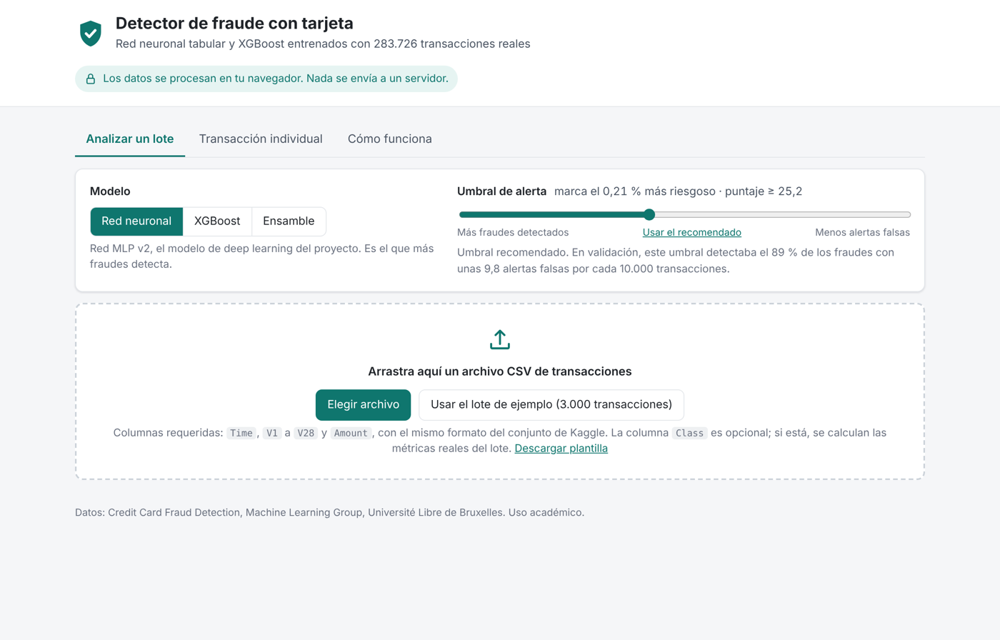
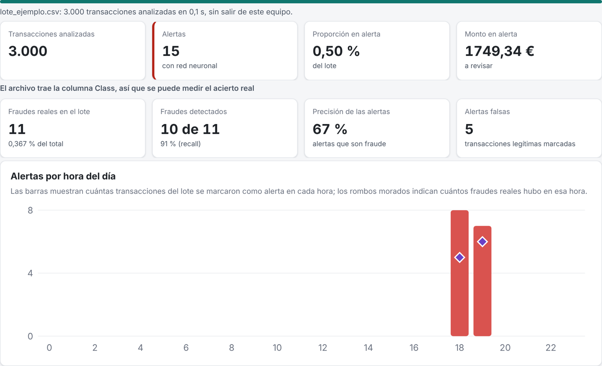
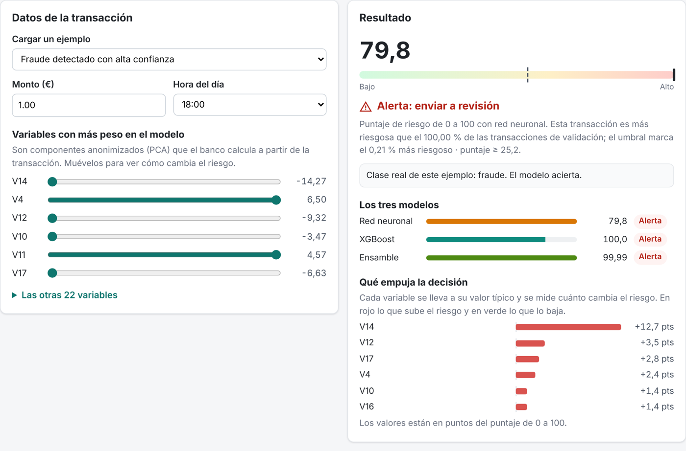

# Detección de fraude en transacciones con tarjeta de crédito

**Red neuronal tabular frente a Gradient Boosting, del dato a una aplicación web desplegada.**

Proyecto de Deep Learning de la Especialización en Inteligencia Artificial,
Facultad de Ingeniería, Universidad de Cundinamarca.

**Aplicación en línea:** https://asvelasquez.github.io/Aplicaciones-Deep-Learning-Credit-Card-Fraud/
(ver [Despliegue](#despliegue-en-github-pages)).



## Contenido

1. [Propósito](#propósito)
2. [Resultados](#resultados)
3. [La aplicación web](#la-aplicación-web)
4. [Estructura del repositorio](#estructura-del-repositorio)
5. [Instalación](#instalación)
6. [Uso](#uso)
7. [Despliegue en GitHub Pages](#despliegue-en-github-pages)
8. [Cómo funciona el modelo en el navegador](#cómo-funciona-el-modelo-en-el-navegador)
9. [Decisiones de diseño](#decisiones-de-diseño)
10. [Límites](#límites)
11. [Fases del proyecto](#fases-del-proyecto)
12. [Datos, licencia y referencias](#datos-licencia-y-referencias)

## Propósito

Los bancos procesan millones de transacciones con tarjeta y solo una fracción
mínima es fraude. En el conjunto usado hay una transacción fraudulenta por cada
578 legítimas. El proyecto responde una pregunta concreta: **¿una red neuronal
diseñada para datos tabulares detecta el fraude igual o mejor que un modelo de
Gradient Boosting cuando ambos se entrenan y evalúan bajo las mismas
condiciones?** Además deja la respuesta convertida en una herramienta que un
analista puede usar para priorizar qué transacciones revisar.

## Resultados

Evaluación sobre las 42.559 transacciones más recientes (52 fraudes), que no se
usaron ni para entrenar ni para elegir el umbral.

| Modelo desplegado | AUPRC | Fraudes detectados | Alertas falsas | Precisión | F1 |
|---|---|---|---|---|---|
| Red neuronal (MLP v2) | 0,768 | 41 de 52 | 48 | 46 % | 0,582 |
| XGBoost v2 | 0,755 | 39 de 52 | 58 | 40 % | 0,524 |
| **Ensamble red + XGBoost** | **0,771** | 39 de 52 | **23** | **63 %** | **0,684** |

- La red y XGBoost **empatan**. En el Avance IV la diferencia de AUPRC fue
  −0,007, con un intervalo bootstrap pareado de −0,030 a 0,011.
- El ensamble detecta casi los mismos fraudes con **menos de la mitad de
  alertas falsas**.
- Hay un grupo de unos 11 fraudes que ningún modelo detecta, porque con las
  variables disponibles se parecen a transacciones normales.

El detalle de todos los experimentos está en `resultados/avances_3_4/`.

## La aplicación web

La aplicación corre por completo en el navegador. La página descarga una sola
vez los pesos de los modelos (unos 350 KB) y hace todos los cálculos en el
equipo del usuario, **así que los archivos que se cargan nunca salen del
navegador**.

| Función | Para qué sirve |
|---|---|
| **Analizar un lote** | Se carga un CSV de transacciones y se obtienen las alertas ordenadas por riesgo, indicadores, alertas por hora y un CSV descargable con los puntajes |
| **Transacción individual** | Se ingresan o ajustan los datos de una transacción y se ven el puntaje de los tres modelos y las variables que más empujan la decisión |
| **Umbral ajustable** | Se elige qué porcentaje de las transacciones más riesgosas se envía a revisión, con una estimación en vivo de fraudes detectados y alertas falsas |
| **Cómo funciona** | Explica el proceso, las métricas en datos nunca vistos y los límites del modelo |

| Resultados de un lote | Transacción individual |
|---|---|
|  |  |

### Formato de los datos de entrada

Un CSV separado por comas, con encabezado, con las mismas columnas del conjunto
de Kaggle:

| Columna | Tipo | Descripción |
|---|---|---|
| `Time` | número ≥ 0 | Segundos desde la primera transacción del periodo. Solo se usa para obtener la hora del día |
| `V1` … `V28` | número | Componentes anonimizados (PCA) que calcula el banco |
| `Amount` | número ≥ 0 | Monto en euros |
| `Class` | 0 o 1, opcional | Si está, la aplicación muestra el acierto real (recall, precisión, alertas falsas) |

Hay una plantilla en `docs/ejemplos/plantilla.csv` y un lote de prueba de 3.000
transacciones con 11 fraudes en `docs/ejemplos/lote_ejemplo.csv`. La
aplicación valida el archivo antes de analizarlo: rechaza archivos sin las
columnas obligatorias, omite filas con valores vacíos, no numéricos o negativos
e informa cuáles fueron, y acepta hasta 300.000 filas, lo que permite cargar el
conjunto completo.

## Estructura del repositorio

```
fraude-tarjeta-dl/
├── README.md
├── requirements.txt
├── config/config.yaml              parámetros del pipeline y de los modelos v2
├── data/raw/                       creditcard.csv (no se versiona, ver Instalación)
├── docs/                           aplicación web publicada en GitHub Pages
│   ├── index.html
│   ├── css/estilos.css
│   ├── js/modelo.js                inferencia: preprocesamiento, red, XGBoost, ensamble
│   ├── js/app.js                   interfaz: carga de archivos, tablas, formulario
│   ├── modelo/                     pesos y parámetros exportados en JSON
│   ├── ejemplos/                   plantilla y lote de ejemplo
│   └── capturas/                   imágenes del README
├── notebooks/
│   ├── eda_figuras.py              análisis exploratorio (Avance II)
│   ├── avances_3_4_colab.ipynb     entrenamiento, pruebas y rediseño (Avances III y IV)
│   └── figuras_informe.py          figuras de los informes
├── resultados/avances_3_4/         métricas, predicciones, modelos entrenados y figuras
├── reports/                        reportes de calidad de datos del pipeline
├── src/
│   ├── data/                       ingesta, validación y partición temporal
│   ├── features/preprocess.py      variables derivadas y escalado
│   ├── models/                     XGBoost, red en PyTorch y ensamble
│   ├── evaluate.py                 métricas, intervalos bootstrap y comparación pareada
│   └── deploy/                     exportación del modelo a la web
│       ├── cargar_pt.py            lee pesos de PyTorch sin tener PyTorch instalado
│       ├── inferencia.py           inferencia de referencia en NumPy
│       └── exportar_modelo.py      genera docs/modelo/*.json y los ejemplos
└── tests/
    ├── paridad.mjs                 corre el modelo JavaScript en Node
    └── test_paridad.py             compara JavaScript con Python en 42.559 transacciones
```

## Instalación

Requisitos: Python 3.10 o superior. Node 18 o superior solo hace falta para la
prueba de paridad.

```bash
git clone https://github.com/Asvelasquez/Aplicaciones-Deep-Learning-Credit-Card-Fraud.git
cd Aplicaciones-Deep-Learning-Credit-Card-Fraud
python -m venv .venv && source .venv/bin/activate      # en Windows: .venv\Scripts\activate
pip install -r requirements.txt
```

Datos: descargar `creditcard.csv` de
[Kaggle](https://www.kaggle.com/datasets/mlg-ulb/creditcardfraud) y dejarlo en
`data/raw/`. No se versiona porque pesa 144 MB, más que el límite de GitHub.

Dependencias principales: pandas, NumPy y scikit-learn para el pipeline;
XGBoost, LightGBM, PyTorch, Optuna y pytorch-tabnet para entrenar. La
aplicación web no necesita ninguna dependencia, es HTML, CSS y JavaScript sin
librerías externas.

## Uso

### 1. Usar la aplicación

En línea, abrir la dirección de GitHub Pages. Para probarla en el propio equipo
hace falta servirla con un servidor local, porque el navegador no deja leer los
archivos del modelo si se abre `index.html` directamente:

```bash
python -m http.server 8000 --directory docs
# abrir http://localhost:8000
```

Ejemplo rápido: en la pestaña *Analizar un lote*, pulsar **Usar el lote de
ejemplo**. Con la red neuronal y el umbral recomendado aparecen 15 alertas, de
las cuales 10 son fraudes reales de los 11 del lote. Al hacer clic en una fila
se abre su explicación en *Transacción individual*.

### 2. Reproducir el pipeline de datos (Avance II)

```bash
python -m src.data.ingest
python -m src.data.validate
python -m src.data.split               # partición temporal 70 / 15 / 15
python -m src.features.preprocess
```

### 3. Entrenar y evaluar los modelos (Avances III y IV)

La forma recomendada es abrir `notebooks/avances_3_4_colab.ipynb` en Google
Colab con GPU T4 y ejecutar todas las celdas (unos 12 minutos). También se
puede usar la línea de comandos:

```bash
python -m src.models.train_gbdt        # XGBoost v2, tres semillas
python -m src.models.train_nn          # red MLP v2, tres semillas (requiere PyTorch)
python -m src.models.ensamble --red red
python -m src.evaluate --nombre gbdt --contra red
```

### 4. Exportar el modelo a la web y verificarlo (Avances V y VI)

```bash
python -m src.deploy.exportar_modelo   # regenera docs/modelo/*.json
python tests/test_paridad.py           # JavaScript frente a Python
```

La prueba de paridad corre el modelo JavaScript sobre las 42.559
transacciones de prueba. El resultado actual es una diferencia máxima de
0,0000003 en el puntaje de la red y ninguna decisión de alerta distinta.

## Despliegue en GitHub Pages

1. Subir el repositorio a GitHub con la carpeta `docs/`.
2. En GitHub: **Settings → Pages → Build and deployment**.
3. En *Source* elegir **Deploy from a branch**, rama `main` y carpeta `/docs`.
   Guardar.
4. A los pocos minutos la aplicación queda en
   https://asvelasquez.github.io/Aplicaciones-Deep-Learning-Credit-Card-Fraud/.

Cada cambio que se sube a `docs/` en la rama `main` se publica solo. El archivo
`docs/.nojekyll` evita que GitHub procese la carpeta con Jekyll.

## Cómo funciona el modelo en el navegador

```
CSV o formulario ─► preprocesamiento ─► red neuronal ─┐
                    (hora circular,     XGBoost ──────┼─► puntaje ─► umbral ─► alerta / normal
                     log del monto,     ensamble ◄────┘
                     escalado robusto)
```

- **Preprocesamiento:** hora del día como seno y coseno, logaritmo del monto y
  escalado robusto con la mediana y el rango intercuartílico del entrenamiento.
- **Red neuronal:** 31 → 128 → 64 → 32 → 1, cada capa oculta con BatchNorm
  (con la media y la varianza guardadas) y ReLU. Tiene 14.913 parámetros.
- **XGBoost:** los 36 árboles que eligió la parada temprana, recorridos nodo a
  nodo con la misma regla de comparación en precisión simple que usa XGBoost.
- **Ensamble:** promedio de la posición de riesgo (percentil) de cada modelo
  frente a las transacciones de validación.
- **Explicación:** cada variable se lleva a su valor típico y se mide cuánto
  cambia el puntaje.

Los pesos se extrajeron del archivo `.pt` de PyTorch y del `.json` de XGBoost
que produjo el entrenamiento. `src/deploy/cargar_pt.py` lee el formato interno
de PyTorch sin necesitar la librería, y la inferencia en NumPy reproduce al
sexto decimal el AUPRC que se obtuvo en Colab.

## Decisiones de diseño

- **Despliegue estático en GitHub Pages:** es gratuito, no se suspende por
  inactividad, no requiere servidor y garantiza la privacidad, porque los datos
  nunca se envían a ningún lado.
- **El riesgo es un puntaje de 0 a 100 y no una probabilidad:** la red se
  entrenó con pérdida focal y XGBoost con un peso grande para los fraudes, así
  que sus salidas sirven para ordenar pero no son probabilidades calibradas.
  Por ejemplo, la mediana de las legítimas en la red es 9. Por eso el umbral se
  expresa como el porcentaje de transacciones más riesgosas que se envía a
  revisión.
- **Carga por lote como modo principal:** las variables V1 a V28 son
  anonimizadas, así que nadie las escribe a mano. El uso realista es un
  analista que carga el lote del día. El formulario individual sirve para
  explorar y explicar casos.

## Límites

- Datos de tarjetas europeas de 2013: el fraude actual puede comportarse distinto.
- Las variables anonimizadas impiden usar el historial del cliente o el tipo de comercio.
- Uno de cada cinco fraudes recibe un puntaje bajo y no se detecta con el umbral recomendado.
- Se despliega una sola semilla de cada modelo (la 42). En el Avance IV el promedio de tres semillas dio un AUPRC muy similar.
- Es una herramienta de apoyo para priorizar revisiones, no una decisión automática de bloqueo.

## Fases del proyecto

| Avance | Contenido | Dónde está |
|---|---|---|
| I | Definición del problema, revisión de cinco artículos, diseño de la solución | Informe Avances I y II |
| II | Pipeline, recolección, análisis exploratorio y preprocesamiento | `src/data`, `src/features`, `notebooks/eda_figuras.py` |
| III | Implementación, pruebas iniciales, análisis de errores y rediseño | `notebooks/avances_3_4_colab.ipynb` |
| IV | Rediseño, comparación estadística, avance y retos | `resultados/avances_3_4/` |
| V | Diseño del front end e inserción de datos | `docs/` |
| VI | Despliegue en la nube, documentación final y socialización | GitHub Pages, este README |

## Datos, licencia y referencias

- Datos: *Credit Card Fraud Detection*, Machine Learning Group, Université
  Libre de Bruxelles (Kaggle). Dal Pozzolo, A. et al. (2018). IEEE TNNLS 29(8), 3784–3797.
- Chen, T. y Guestrin, C. (2016). XGBoost: A scalable tree boosting system. KDD.
- Gorishniy, Y. et al. (2021). Revisiting deep learning models for tabular data. NeurIPS.
- Grinsztajn, L. et al. (2022). Why do tree-based models still outperform deep learning on typical tabular data? NeurIPS.
- Lin, T.-Y. et al. (2017). Focal loss for dense object detection. ICCV.

Código publicado con fines académicos.
